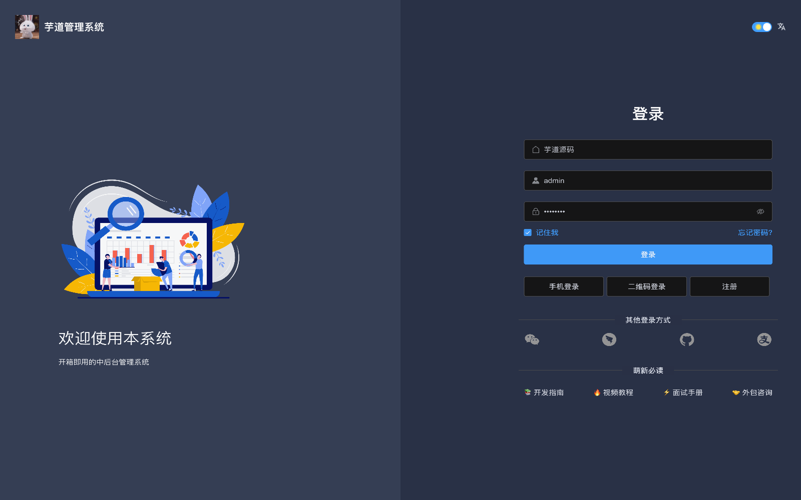
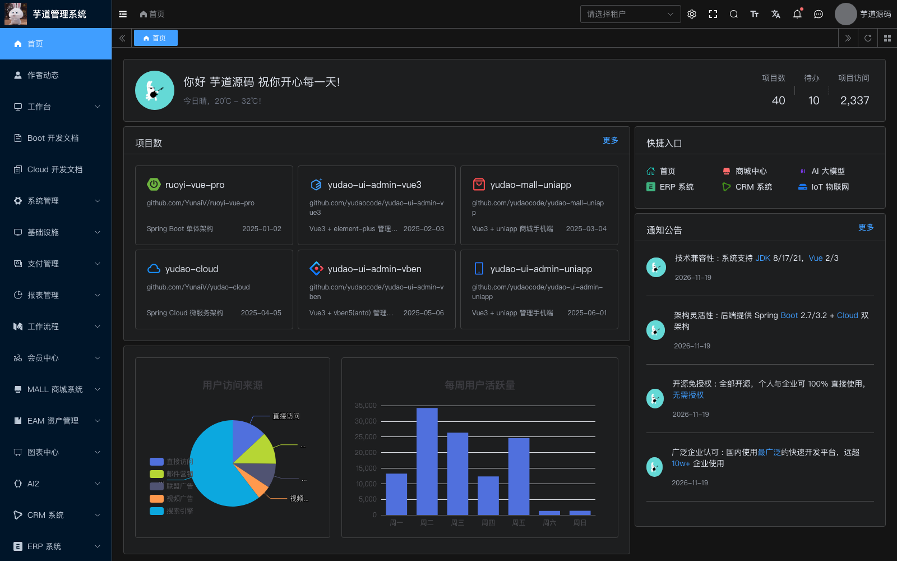

# 中台网关治理改造（基于 yudao-cloud）

[](https://github.com/chendi-Shi/yudao-cloud-middle-platform-lab/actions/workflows/ci.yml)


> 一个面向大厂中台 / 基础架构方向的工程实践仓库：在开源微服务中台底座上，补齐**网关治理**（限流、内部签名、灰度）与**分布式事务**（Seata AT），并且为每个技术选型给出可复现的压测数据。

**上游项目**：[YunaiV/yudao-cloud](https://github.com/YunaiV/yudao-cloud)（19.8k★，MIT License，Java 17 + Spring Boot 3.5 + Spring Cloud Alibaba）
**本仓库做的事**：不改业务、不重写框架，只在网关层和服务框架层做 4 个可度量的改造，并沉淀成文档。

> 📖 想先看**过程**（选题、踩过的 20 个坑、每个坑怎么解决）？→ [docs/00-项目全历程](docs/00-项目全历程.md)
> 🔍 想看**选型推导**（为什么 A 不用 B）？→ [docs/01](docs/01-网关统一接入-设计与选型.md) 和 [docs/03](docs/03-Seata分布式事务.md)

---

## 一、做了什么

| # | 能力 | 实现要点 | 证据 |
| --- | --- | --- | --- |
| 1 | **网关令牌桶限流** | Redis + Lua 原子执行；维度=租户+用户；规则按 path 隔离；429 + `Retry-After` | 3000 并发请求中 **88.2% 在网关被拦截**，只有 355 个落到后端；限流自身开销 < 5%（噪声内） |
| 2 | **内部调用 HMAC 签名** | `HmacSHA256(ts + nonce + method + path)`，60s 时间窗 + Redis SETNX 防重放，常量时间比较 | 直连服务端口 → 401；经网关 → 200；伪造签名 → 401；`/rpc-api` 不受影响 |
| 3 | **百分比灰度分流** | Murmur3 一致性哈希，同一用户稳定命中同一版本；决策写入 `header[version]`，复用上游 LB 选实例 | 100% 灰度时 **30/30** 请求落到 v2 实例；关闭灰度时 **22/40**（轮询对照） |
| 4 | **Seata AT 分布式事务** | 订单在 system-server、扣余额在 infra-server，XID 经 Feign 透传 | 成功：订单写入 + 余额扣减；失败：**订单回滚、余额不变**；Seata 日志完整 `Begin → BranchRegister → Rollback → PhaseTwo_Rollbacked` |

配套：**29 个自动化测试**（含 Testcontainers 真实 Redis）、**GitHub Actions CI**、6 份文档、6 组压测与故障演练、Vue3 管理后台跑通。

## 二、架构

```
Vue3 后台 (8090) ──► 网关 48080
                       ├─ ① Token 认证        order=-100
                       ├─ ② 令牌桶限流         order=-50   ← 新增
                       ├─ ③ 灰度分流           order=-20   ← 新增
                       └─ ④ 内部签名           order=-10   ← 新增
                            │
        ┌───────────────────┼────────────────────┐
        ▼                   ▼                    ▼
  system-server(v1)    system-server(v2)    infra-server
        │                   │                    │
        ├─ 订单库 ───────────┼────────────────────┤
        └────── Feign(XID) ─┴───────────────────►└─ 账户库
                                                        │
                                              Seata Server 18091
```

**三类入口的边界**（这是设计里最容易出错的地方）：

| 路径 | 调用方 | 是否签名 | 是否限流 |
| --- | --- | --- | --- |
| `/admin-api/**`、`/app-api/**` | 外部 → 网关 | ✅ | ✅ |
| `/rpc-api/**` | 服务间 Feign 直连 | ❌（不经过网关，签了也没人验） | ❌ |
| `/actuator/**` | 运维探针 | ❌（否则健康检查失败、服务被摘除） | ❌ |

## 三、关键数据

### 网关限流（ab，3000 请求 / 50 并发）

| 场景 | 吞吐 | P99 | 失败 |
| --- | --- | --- | --- |
| 基线（无限流） | 621 ~ 662 req/s | 175 ~ 189 ms | 0 |
| 限流 100 QPS / 桶 200 | 总 2461 req/s（含被拒） | 129 ms | **88.2% 被 429 拒绝** |
| 限流开启但阈值打满 | 658 ~ 698 req/s | 130 ~ 145 ms | 0 |

> 一个数据陷阱：429 是廉价响应，会把 `ab` 报的 QPS 抬高近 4 倍。只看吞吐会得出「限流提升性能」的错误结论。

### 分布式事务并发（80 请求 / 20 并发）

| 场景 | 吞吐 | P99 |
| --- | --- | --- |
| 不开 AT + 不同账户 | 250 req/s | 124 ms |
| 不开 AT + 同一账户 | 200 req/s | 152 ms |
| AT + 不同账户 | 65 req/s | 450 ms |
| AT + 同一账户 | 52 req/s | **529 ~ 921 ms** |

结论：**AT 的主要成本是协议开销（吞吐 −74%），全局锁竞争是叠加项**，且会让尾延迟极不稳定（同一负载两轮 p99 差 74%）。

## 四、选型速览（每条都有更详细的取舍文档）

| 决策 | 选择 | 核心理由 |
| --- | --- | --- |
| 限流算法 | 令牌桶 | 固定窗口有 2 倍临界突刺；漏桶不允许正常突发 |
| 计数存储 | Redis | 网关多实例，本地桶限不住集群总量 |
| 原子性 | Lua 脚本 | `GET`+`SET` 有 check-then-act 竞态，会超卖令牌 |
| 限流位置 | 网关 | 规则集中，避免几十个服务各写一份 |
| 故障策略 | fail-open | 网关挂是 P0，限流失效只是少一层保护 |
| 拒绝码 | 429 | 429=退避重试；503=服务故障，语义不同 |
| 防绕过 | HMAC 签名 | mTLS 成本过高，JWT 对内部调用是浪费 |
| 签名范围 | 含 method + path | 只签时间戳，签名可被挪用到其它接口 |
| 校验路径 | 仅 admin/app | 全量校验会打死 Feign 的 `/rpc-api` 调用 |
| 灰度 key | userId 哈希 | 随机会让同一用户反复跳版本；IP 会随基站变化 |
| 灰度决策位置 | 网关 Filter | LB 只负责「选实例」，不该同时决定「选哪个版本」 |
| 分布式事务 | AT | 零业务改造；TCC 要写三接口，本地消息表是异步语义 |

## 五、质量保障

| 手段 | 内容 |
| --- | --- |
| 单元测试 | 签名契约、灰度分流（稳定性/比例/边界） |
| 集成测试 | 网关签名过滤器（4 个场景）、限流过滤器（6 个场景，含 fail-open/fail-close）、服务端验签（7 个场景，含篡改/重放/过期） |
| 容器测试 | Testcontainers 拉起真实 Redis，验证 Lua 令牌桶的「突发 → 拒绝 → 补充 → 隔离」 |
| CI | GitHub Actions：JDK 17 + Maven 缓存 + 构建 + 全量测试（push / PR 触发） |
| 故障演练 | 见 [docs/06](docs/06-故障演练.md) |

```bash
# 本地跑全部测试
mvn -B test -pl yudao-framework/yudao-common,yudao-framework/yudao-spring-boot-starter-security,yudao-gateway \
  -Dtest='InternalSign*Test,GrayRoutingFilterTest,RateLimitFilterTest,TokenBucketRateLimiterContainerTest' -DfailIfNoTests=false
```

## 六、截图

| 登录 | 工作台 |
| --- | --- |
|  |  |

## 七、快速开始

```bash
# 1. 中间件（MySQL / Redis / Nacos）
cd script/docker-compose
cp .env.example .env          # 修改三个密码
docker compose -f docker-compose.yml -f docker-compose.local.yml up -d mysql redis nacos

# 2. 编译（JDK 17 + Maven）
cd ../..
mvn clean install -DskipTests \
  -pl yudao-gateway,yudao-module-system/yudao-module-system-server,yudao-module-infra/yudao-module-infra-server -am

# 3. 启动（脚本里已配好数据源、限流、签名等环境变量）
./local-dev.sh system     # 48081
./local-dev.sh infra      # 48082
./local-dev.sh gateway    # 48080

# 4. 验证
curl -X POST http://127.0.0.1:48080/admin-api/system/auth/login \
  -H 'Content-Type: application/json' -H 'tenant-id: 1' \
  -d '{"username":"admin","password":"admin123"}'
```

前端（独立仓库）：`yudaocode/yudao-ui-admin-vue3`，`.env.local` 指向 `http://localhost:48080`，`corepack pnpm@10 dev`。

## 八、文档索引

| 文档 | 内容 |
| --- | --- |
| [docs/00-项目全历程](docs/00-项目全历程.md) | 12 个阶段的时间线 + 20 个问题总表 + 决策总表 + 计划偏差 |
| [docs/01-网关统一接入-设计与选型](docs/01-网关统一接入-设计与选型.md) | 全景 + 15 组 A/B 选型取舍 |
| [docs/02-压测报告](docs/02-压测报告.md) | 限流压测的原始数据与陷阱 |
| [docs/03-Seata分布式事务](docs/03-Seata分布式事务.md) | AT 原理、AT/TCC/消息表选型、4 个坑 |
| [docs/04-前端联调与灰度验证](docs/04-前端联调与灰度验证.md) | 双实例灰度验证方法 |
| [docs/05-并发全局事务压测](docs/05-并发全局事务压测.md) | AT 开销与全局锁竞争的分离实验 |
| [docs/06-故障演练](docs/06-故障演练.md) | 实例宕机 / Redis 故障 / Nacos 宕机三组演练 |
| [本地跑通笔记](本地跑通笔记.md) | 环境、启动、遇到的 5 个坑 |

## 九、仓库结构（本仓库新增的部分）

```
yudao-gateway/src/main/java/.../filter/
├── ratelimit/            # 令牌桶限流（Redis + Lua）
├── security/InternalSignFilter.java
└── grey/GrayRoutingFilter.java

yudao-framework/yudao-common/.../util/sign/InternalSignUtils.java      # 共享签名契约
yudao-framework/yudao-spring-boot-starter-security/.../core/sign/      # 服务端验签 + 防重放

yudao-module-*/.../seatademo/                                          # Seata 演示
script/seata/                                                          # Seata Server 配置 + SQL + 压测脚本
docs/                                                                  # 全部设计文档
```

## 十、局限

1. 所有压测均为**单机单实例**，绝对数值不可外推到生产
2. Seata Server 使用 **file 单机存储**，未做集群与 db 存储
3. AT 的隔离性只有「读未提交」，热点行场景未做拆行优化
4. 未接入链路追踪（SkyWalking），排障依赖日志
5. 灰度仅支持单版本百分比，无租户白名单 / 多版本并存

## 十一、声明

- 本仓库基于 [YunaiV/yudao-cloud](https://github.com/YunaiV/yudao-cloud)（MIT License）二次开发，**框架本身为上游作品**，原始 README 见 [README-UPSTREAM.md](README-UPSTREAM.md)
- 本仓库的增量在于：网关治理层（限流 / 签名 / 灰度）、Seata 接入与演示、以及配套的压测与设计文档
- 文档中的性能数字均在本机实测，复现脚本已随仓库提供
