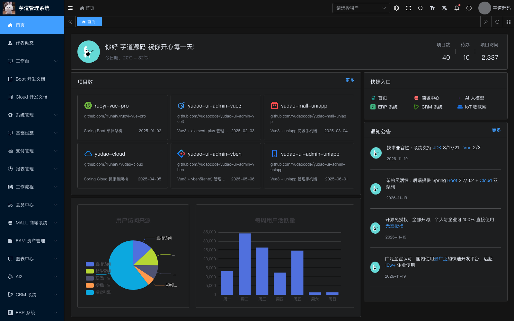

# 前端联调 + 灰度端到端验证

## 一、前端跑起来了

前端是独立仓库 `yudaocode/yudao-ui-admin-vue3`（Vue3 + element-plus + Vite 8），这次也拉下来跑通了。

```bash
# 依赖（用 pnpm 10，仓库要求 >=10.28.0）
corepack pnpm@10 install

# 关键配置（.env.local）
VITE_BASE_URL='http://localhost:48080'   # 指向本项目的网关
VITE_API_URL=/admin-api
VITE_APP_CAPTCHA_ENABLE=false            # 与后端 YUDAO_CAPTCHA_ENABLE 保持一致
VITE_PORT=8090                           # 避开 80 端口（要 root）

corepack pnpm@10 dev                     # → http://localhost:8090
```

**登录页**


**登录后的工作台**（账号 admin / admin123，租户「芋道源码」）



这一步的价值不只是「好看」：它证明了**整条链路真的通了**——浏览器 → Vite → 网关 48080（限流 + 签名）→ Nacos → system-server → MySQL。
如果内部签名写错了（比如 path 规范不一致），登录会直接 401；如果限流配错了，页面会一直转圈。**前端是最好的端到端测试。**

## 二、灰度：双实例端到端验证

之前只有单测覆盖了「分流决策」，没有证明「真的路由到了不同实例」。这次补上了。

### 方法

1. 起第二个 `system-server`（端口 48083），注册到 Nacos 时把 `metadata.version` 设成 `v2`：

```bash
SERVER_PORT=48083 \
SPRING_CLOUD_NACOS_DISCOVERY_METADATA_VERSION=v2 \
SERVER_TOMCAT_ACCESSLOG_ENABLED=true \
SERVER_TOMCAT_ACCESSLOG_DIRECTORY=$PWD/logs/access-b \
SERVER_TOMCAT_ACCESSLOG_PREFIX=b_access \
./local-dev.sh system
```

2. 第一个实例保持默认 `metadata.version=1.0.0`。Nacos 里能看到两个实例：

```
192.168.1.34 48081  version=1.0.0
192.168.1.34 48083  version=v2
```

3. 用 B 实例的 **Tomcat access log** 作为「谁处理了请求」的客观证据（Actuator 的 `http.server.requests` 在这个项目里没采集到数据）。

### 结果

| 场景 | 操作 | B 实例收到的请求 | 结论 |
| --- | --- | --- | --- |
| 灰度 100% | `gray.enabled=true, percent=100`，经网关发 30 个请求 | **30 / 30** | 分流决策 → header[version]=v2 → LB 只选 v2 实例 |
| 灰度关闭 | `gray.enabled=false`，经网关发 40 个请求 | **22 / 40** | 退回默认轮询，两个实例各约一半 |

两组数据合起来才有说服力：
- 100% 时全部命中 B，说明**分流决策生效了**；
- 关闭时约一半命中 B，说明 B 确实在参与负载均衡，前一组不是「碰巧只有 B 在线」。

### 为什么不用「杀掉 A 实例」来验证

因为 `GrayLoadBalancer` 有个兜底逻辑：**当没有实例匹配 version 时会回退到全部实例**。所以杀掉 A 之后，带 `version=v2` 的请求即便找不到 v2 也能被 A 处理，看起来「正常」，证明不了任何事。这是个很容易被误读的设计点，值得记住。

## 三、这次验证暴露的一个真实问题

第一版我用 Actuator 的 `/actuator/metrics/http.server.requests` 统计实例请求数，结果拿到了一个空的指标列表（0 个 metric）——这个项目的监控端点没有采集 Web 请求指标。

**如果不去验证「指标是不是真的有数据」，就会写出一份「看起来有数据、其实是空」的报告。** 后来改用 Tomcat access log，才有可以逐行核对的证据。

## 四、复现

```bash
# 前端
cd yudao-ui-admin-vue3 && corepack pnpm@10 dev   # 8090

# 第二实例
cd yudao-cloud && SERVER_PORT=48083 \
  SPRING_CLOUD_NACOS_DISCOVERY_METADATA_VERSION=v2 \
  SERVER_TOMCAT_ACCESSLOG_ENABLED=true \
  SERVER_TOMCAT_ACCESSLOG_DIRECTORY=$PWD/logs/access-b \
  SERVER_TOMCAT_ACCESSLOG_PREFIX=b_access \
  ./local-dev.sh system

# 网关开灰度
YUDAO_GATEWAY_GRAY_ENABLED=true \
YUDAO_GATEWAY_GRAY_RULES_0_VERSION=v2 \
YUDAO_GATEWAY_GRAY_RULES_0_PERCENT=100 \
./local-dev.sh gateway
```
